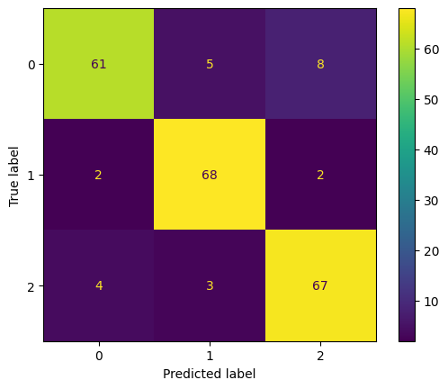

# Student Stress: SVM + Pipeline + GridSearchCV

Classificação do nível de estresse de estudantes (baixo, moderado
ou alto) com SVM, Pipeline do scikit-learn e ajuste de
hiperparâmetros com GridSearchCV. Projeto da disciplina de
Inteligência Artificial (UMC). Projeto educacional, não é uma
ferramenta de diagnóstico.

## Dados
- [Student Stress Factors (Kaggle)](https://www.kaggle.com/datasets/rxnach/student-stress-factors-a-comprehensive-analysis), de rxnach, baixado automaticamente com `kagglehub`.
- 1.100 linhas, 20 variáveis numéricas e o alvo `stress_level` (0 = baixo, 1 = moderado, 2 = alto).
- Sem valores nulos nem linhas duplicadas, então não foi necessária limpeza.

## Pipeline
| Etapa | O que foi feito |
|---|---|
| Divisão | 80% treino, 20% teste, com `stratify` para manter a proporção das 3 classes |
| Normalização | `StandardScaler` dentro de um `Pipeline`, que aprende só com o treino de cada fold (evita vazamento de dados) |
| Modelo base | `SVC` com parâmetros padrão |
| Otimização | `GridSearchCV`, `cv=5`: kernel [linear, rbf, sigmoid], C [0.1, 1, 10], gamma [0.01, 0, 1, 1] |

## Resultados
| Modelo | Acurácia no teste |
|---|---|
| SVM (padrão) | 87,73% |
| SVM + GridSearchCV | 89,09% |

Melhores parâmetros: {'svm__C': 10, 'svm__gamma': 0.01, 'svm__kernel': 'linear'}

Leitura da matriz (220 amostras de teste, linhas = valor real, colunas = previsão): o modelo acerta mais a classe moderada, 68 de 72 (94%), e erra mais na classe baixa, 61 de 74 (82%), que ele confunde com moderada e alta. Na classe alta acerta 67 de 74 (91%).

## Conceitos aplicados
- **Padronização:** o SVM usa distâncias, então atributos em escalas diferentes distorcem a margem.
- **Gamma (RBF):** valores altos reduzem o raio de influência de cada ponto e levam a fronteiras muito curvas, com risco de overfitting.
- **Acurácia, precisão e recall:** em classes desbalanceadas a acurácia sozinha engana.
- **One-Hot Encoding:** não foi necessário, porque todas as variáveis já são numéricas.

## Como rodar
Abra pelo botão do Colab e execute as células de cima para baixo. O dataset é baixado automaticamente.

## Autor
Pedro Henrique Diniz Matos
